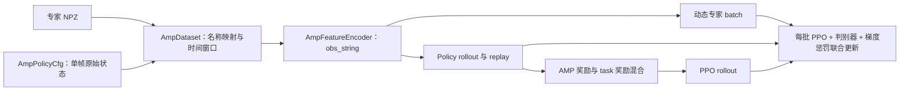

# AMP 数据与训练链路

训练沿用 AMP_mjlab 的 replay、最小二乘判别器、原始特征梯度惩罚、二次 AMP 奖励和 AC/判别器联合更新。机器人状态通过 Isaac Lab 采集；专家和 policy 共用可配置的特征处理入口。

## 文件职责

| 文件 | 职责 |
| --- | --- |
| `src/z_lab/tasks/amp/amp_env_cfg.py` | `AmpPolicyCfg` 输出全部 body/joint 的单帧原始状态，开启 `compute_final_obs` |
| `src/z_lab/tasks/amp/mdp/motion_loader.py` | 独立加载环境 reset 使用的原始运动状态 |
| `src/z_lab/tasks/amp/mdp/events.py`、`terminations.py` | 运动状态 reset、倒地延迟终止及恢复 |
| `rsl_rl/rsl_rl/utils/amp_dataset.py` | 独立读取专家 NPZ、名称映射、policy history、rollout、replay 和训练采样 |
| `rsl_rl/rsl_rl/utils/amp_features.py` | 按 `obs_string` 顺序，为专家与 policy 生成相同语义的特征 |
| `rsl_rl/rsl_rl/models/amp_discriminator.py` | 特征归一化、判别器预测与损失、梯度惩罚、AMP 奖励及旧归一化统计迁移 |
| `rsl_rl/rsl_rl/algorithms/amp_ppo.py` | 构建 Dataset、消费原始观测、联合优化、训练状态与检查点调度 |
| `src/z_lab/tasks/amp/config/g1/agents/rsl_rl_amp_cfg.py` | PPO、MoE 和 AMP 参数 |



Dataset 从环境配置取得运动路径、articulation 的完整名称顺序、默认关节状态和控制周期。它自行加载 NPZ，不访问 `env.amp_motion_loader` 的池对象。reset loader 与训练 Dataset 分别拥有各自的数据。

## 可设置的判别器观测

Python 配置使用与 Isaac Lab 的 RSL-RL 配置一致的属性接口，在 `algorithm.amp_cfg.dataset_cfg` 中设置。配置经 `to_dict()` 序列化后，训练算法仍接收普通字典，原有字典配置可继续使用：

```python
{
    "num_frames": 2,
    "history_stride": 1,
    "recovery_sample_ratio": 0.2,
    "replay_buffer_size": 100_000,
    "obs_string": [
        "body_pos_b",
        "body_ori_b",
        "body_lin_vel_b",
        "body_ang_vel_b",
        # "body_gravity_b",  # 可选：anchor 重力投影，每帧 3 维
        # "joint_pos",
        # "joint_vel",
    ],
}
```

例如，在 Python 中修改特征与时间窗口：

```python
agent_cfg.algorithm.amp_cfg.dataset_cfg.obs_string = [
    "body_pos_b", "body_ori_b", "body_lin_vel_b", "body_ang_vel_b", "body_gravity_b",
]
agent_cfg.algorithm.amp_cfg.dataset_cfg.num_frames = 4
agent_cfg.algorithm.amp_cfg.dataset_cfg.history_stride = 2
```

`RslRlAmpCfg`、`RslRlAmpDatasetCfg`、`RslRlAmpDiscriminatorCfg` 分别定义扩展、数据和模型参数。判别器通过原生 `resolve_class()` 解析 `class_name`，默认使用明确的模块路径 `rsl_rl.models:AMPDiscriminator`。构建阶段只向配置补充路径、名称顺序、默认关节状态和控制周期；Dataset 在 `AMPPPO.__init__()` 中创建，避免原生配置深拷贝复制专家池和 replay 缓冲区。Actor/Critic、PPO storage 和编译继续使用 `PPO.construct_algorithm()`。

| 特征 | 每帧语义 |
| --- | --- |
| `body_pos_b` | 相对当帧 anchor 的位置，表达在 anchor 完整局部坐标系 |
| `body_ori_b` | 相对 anchor 的旋转矩阵前两列，按 `(R00, R01, R10, R11, R20, R21)` 展平 |
| `body_lin_vel_b` | 世界线速度转到各 body 自身坐标系，不减 anchor 速度 |
| `body_ang_vel_b` | 世界角速度转到各 body 自身坐标系，不减 anchor 角速度 |
| `body_gravity_b` | 单位重力 `(0, 0, -1)` 在 anchor 坐标系下的投影 |
| `joint_pos` | 选定关节位置减机器人默认位置，乘 `joint_pos_scale` |
| `joint_vel` | 选定关节速度减机器人默认速度，乘 `joint_vel_scale` |

G1 默认选择 `G1_AMP_LINK_NAMES` 的 13 个 body，anchor 为 `torso_link`。原始 policy 观测包含全部 articulation body/joint，NPZ 字段按名称映射到相同顺序，然后由 Encoder 按 `body_names`、`joint_names` 选取和排列。`obs_string` 决定每帧拼接顺序，历史帧按从旧到新排列。

默认四项特征为每帧 `13 × (3 + 6 + 3 + 3) = 195` 维；两帧输入为 390 维。追加 anchor 重力后为每帧 198 维、两帧 396 维。维度由 Encoder 自动推导。新增特征可以通过 `register_amp_feature` 注册，函数同时服务专家与 policy。

## 采样和时序

- `history_stride` 表示控制步间隔。`num_frames=2, history_stride=1` 取 `[t-1, t]`；`4, 2` 取 `[t-6, t-4, t-2, t]`。NPZ fps 必须与控制频率相同，当前不执行重采样。
- 每个专家 batch 分配 `int(batch_size * recovery_sample_ratio)` 个恢复窗口；池内随机等概率选文件，再随机选合法窗口起点。窗口不跨文件，过短文件不参与采样。
- episode 开始时，用第一帧填满 history。实际 done 时先追加 reset 前的 `final_obs`，生成旧 episode 的最后一个窗口和对应奖励，再用 reset 状态填满新 episode history。DelayManager 仍在延迟时继续原 episode。
- 默认 replay 保存最近 100000 个已编码 policy 窗口，跨 rollout 保留。每次联合优化从 replay 有放回抽样，batch 大小为 `num_envs * num_steps_per_env // num_mini_batches`，不随 replay 容量增大。
- `replay_buffer_size=0` 保留只使用当前 rollout 的模式：每个 epoch 打乱全部 policy 样本，并保留不能整除的尾批。每批动态采样等量专家窗口。
- 更新结束后清空当前 rollout。连续 episode 的 history 和 replay 继续保留。

## 联合训练与日志

每个 PPO mini-batch 同时计算：

```text
amp_loss = 0.5 * (MSE(D(expert), +1) + MSE(D(policy), -1))
grad_pen = grad_pen_coef * E[||∇expert D_raw(expert)||²]
total_loss = PPO_loss + amp_loss + grad_pen
```

AC 与判别器共用优化器、学习率、自适应 KL 调度、`num_learning_epochs` 和 `num_mini_batches`。按照 AMP_mjlab，对 AC 的组合梯度范数裁剪，判别器梯度不裁剪。判别器 trunk/head 的默认 weight decay 分别为 `1e-3` 和 `1e-1`。

`AMPDiscriminator.compute_loss()` 统一计算判别器目标和六项 AMP 指标，`AMPPPO` 将其加入 PPO 的同一次反向传播。指标在设备上累加，每轮更新结束后统一转为日志数值。判别器 batch 迭代器和待归一化数据在更新结束或异常退出时释放；原始 policy history 和 replay 仍由 Dataset 管理。

归一化直接使用 RSL-RL 自带的 `EmpiricalNormalization`，各历史帧共用一套单帧均值和方差。采用其默认公式 `(x - mean) / (std + eps)`，`obs_eps=1e-2`；判别器另外保留 `obs_clip=10.0` 的裁剪，可设为 `None` 关闭。当前 batch 用已有统计计算损失；优化器更新后，将两端的原始特征帧加入统计，并对 actor 标准差施加 `min_normalized_std` 下限。该下限可设置为标量或与动作数一致的列表。多 GPU 下由自带 normalizer 同步统计。

奖励保持：

```text
style_reward = amp_reward_coef * max(0, 1 - 0.25 * (D(policy) - 1)²)
training_reward = (1 - task_reward_lerp) * style_reward + task_reward_lerp * task_reward
```

Mean reward 与 `Train/mean_reward` 记录混合后的训练奖励；`Episode_Reward/*` 仍显示环境各项奖励。以下判别器指标同时输出到控制台和 TensorBoard：

```text
Loss/amp_loss
Loss/amp_expert_loss
Loss/amp_policy_loss
Loss/amp_grad_pen
Loss/amp_policy_pred
Loss/amp_expert_pred
```

普通 AMP 和 MoE 使用恢复专家比例 `0.2`。MoE 同时替换 actor 和 critic；NoRecovery 使用 `0.0`，并关闭倒地延迟及恢复 reset。

## 保留的项目约定与检查点迁移

参考 AMP_mjlab 使用单批循环选专家文件、末帧重复以及用上一帧代替终止状态。本项目保留恢复池混合、随机等概率选文件、合法窗口和真实 `final_obs`。归一化只吸收原始特征，避免将归一化后的结果再次用于更新统计；这些行为保持两端的数据语义一致。

删除了 `discriminator_cfg.learning_rate`、`discriminator_cfg.max_grad_norm` 和公共 `weight_decay` 别名。已有自定义配置应删除前两项，weight decay 分别使用 `trunk_weight_decay`、`head_weight_decay`。

已删除独立的 `amp_normalizer.py`，统一使用自带 normalizer。旧归一化采用 `(x - mean) / sqrt(var + eps)`，与现在的公式存在数值差异。加载旧 AMP 检查点时，自动转换统计字段；若旧统计按历史位置保存，则合并各位置的均值、方差和样本数。网络权重和共享优化器状态继续加载；新统计方式下的判别器输出可能与旧版本不同。改变 `obs_string`、body/joint 顺序或时间窗口后，应使用新判别器，或仅加载兼容的 actor/critic。

直接构造 `AMPPPO` 时，使用 `amp_cfg["dataset_cfg"]` 传入 `AmpDataset` 的路径、完整名称顺序、anchor、`step_dt` 和采样参数；`num_envs`、`num_steps_per_env` 从 PPO storage 取得，`device` 使用算法设备。旧的 `amp_cfg["amp_dataset"]` 实例注入暂时保留，并产生 `DeprecationWarning`；不要同时传入两个字段。检查点中的网络与优化器字段保持不变。

验证命令：

```bash
PYTEST_DISABLE_PLUGIN_AUTOLOAD=1 .venv/bin/python -m pytest \
    tests/test_amp_dataset.py tests/test_amp_discriminator.py \
    tests/test_amp_motion.py tests/test_registration.py -q
```
